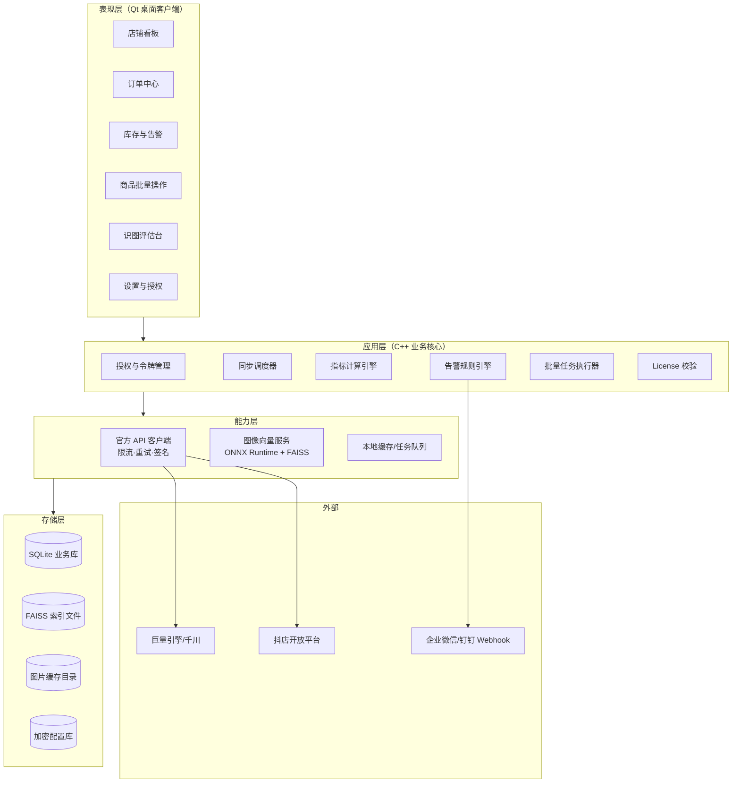
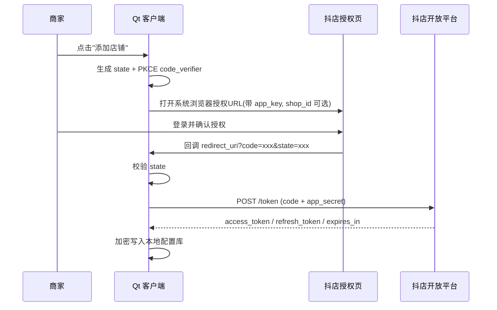
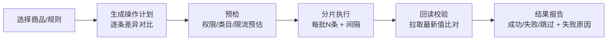

# 红果短剧电商商家赋能工具 · 完整技术方案

| 项 | 内容 |
|---|---|
| 文档版本 | v1.0 |
| 编写日期 | 2026-11-16 |
| 文档类型 | 产品 + 技术方案（PRD / 架构设计 / 工程实施 合一） |
| 面向读者 | 项目发起人（主开发者）、潜在合作方、外部技术评审 |
| 目标读者背景 | 具备 C++ / Qt / QML / VTK 开发经验，Windows 桌面方向为主 |
| 交付形态 | Windows 桌面客户端（Qt）+ 可选轻量后端服务（可选 Web 管理台） |
| 合规基线 | 仅使用抖店开放平台 / 巨量引擎开放平台官方 API；禁止爬虫、抓包、逆向 |

---

## 0. 摘要（TL;DR）

### 0.1 一句话定位

> 不做卖家、不做达人、不做短剧制片，做**合规的商家侧技术服务工具**：
> 用官方开放 API 把「红果渠道订单 / 库存 / 体验分 / 投放 ROI」做成商家能看的看板 + 能自动执行的批量操作，
> 再用**本地图像相似度检索**帮商家评估「自家商品图是否容易被红果短剧识图命中」。

### 0.2 三条不可逾越的红线

1. **数据来源只走官方开放 API**，不做任何抓包、逆向、模拟登录、批量爬取。
2. **不碰短剧视频流**，不下载、不切片、不批量采集红果内容；图像检索的输入图片只能是**商家自己上传的商品图与自持截图**。
3. **不做效果承诺**，产品内不得出现「保证上同款」「破解识别」「内部流量通道」类表述；所有识别结果标注为「内部参考评估」。

### 0.3 关键结论

| 决策项 | 结论 | 理由 |
|---|---|---|
| 商业模式 | 订阅制 + 私有化部署 + 定制开发 | 现金流稳定，不依赖爆品波动 |
| 前端形态 | **MVP 用 Qt 桌面端**，V2 再补 Web 管理台 | 图片密集操作、本地推理、个人技术栈匹配 |
| 图像检索部署 | 本地 CPU 推理（ONNX Runtime + FAISS） | 图片不出本地，合规且低延迟 |
| 首版功能范围 | 授权 → 订单/渠道看板 → 库存与爆单告警 → 本地识图评估 | 4 个功能闭环即可验证付费意愿 |
| 时间投入 | MVP 2 周，V1 6 周，V2 3 个月 | 单人可推进，每个阶段都有可售物 |

---

## 1. 业务背景

### 1.1 红果电商是什么

红果（红果免费短剧）是字节体系内的短剧 App。红果电商**不是一个独立电商平台**，而是**抖音电商（抖店）的一个流量渠道**：

- 商家不需要单独入驻红果，也不需要单独签红果协议；
- 在抖店开店并上架商品后，商品会进入红果 App 的商城货架与「短剧搜同款」候选池；
- 用户在短剧播放过程中，平台侧识别画面中的商品（服饰、家居、饰品、小家电等），弹出「搜同款」入口；
- 成交订单、支付、售后、结算、物流全部复用抖音电商体系，红果只贡献**流量入口与渠道标识**。

**推论（对本项目的直接影响）：**

1. 所有数据都能在抖店开放平台拿到，只是订单需要按**渠道字段**拆分 —— 这是本项目全部数据能力的基础。
2. 平台侧的「识图搜同款」模型是黑盒，外部无法调用、无法预测，也无法验证。任何声称能"预测命中"的工具都在说谎。我们只能提供**离线相似度参考**。
3. 渠道流量的爆发性极强（一条剧爆了，某品类订单可能在数小时内增长数十倍），因此**库存与发货时效监控**的实用价值高于选品工具。

### 1.2 商家真实痛点（按付费意愿排序）

| # | 痛点 | 现状 | 后果 | 优先级 |
|---|---|---|---|---|
| P1 | 多渠道数据混合，看不出红果单独表现 | 抖店后台只给全店数据，渠道维度要人工筛 | 无法判断该给红果铺什么货 | ★★★★★ |
| P2 | 短剧爆单导致超卖 / 超时发货 | 人工盯库存，夜间无人值守 | 平台扣分、限流、赔付 | ★★★★★ |
| P3 | 商品图不适配识图（大量白底图） | 商家不知道图会被识别失败 | 白铺货，拿不到搜同款流量 | ★★★★☆ |
| P4 | 多店铺 / 多账号分散管理 | 反复切换后台，Excel 手工汇总 | 人力成本高，易错 | ★★★★☆ |
| P5 | 千川红果流量包投产不透明 | 消耗与成交在不同后台 | 投了不知道赚没赚 | ★★★☆☆ |
| P6 | 批量操作（改库存/改标题/下架）纯手工 | 逐个点 | 大促、爆单时来不及 | ★★★☆☆ |

> **注意 P3 的表述边界**：我们的工具只能告诉商家「你的图在离线模型下与某张参考图的相似度是多少」，以及「这张图是白底图/纯商品平铺图，缺少使用场景」。**不能声称这会提高平台识别率**。产品文案必须是建议性、可解释的，不能是因果承诺。

### 1.3 目标客户分层

| 分层 | 典型画像 | 规模判断 | 付费能力 | 产品形态偏好 |
|---|---|---|---|---|
| A. 单店小商家 | 1~3 人，个体户，一件代发 | 最大基数 | 99~299 元/月 | 桌面绿色包，开箱即用 |
| B. 多店工作室 | 5~20 人，5~30 家店，有美工/运营分工 | 中 | 998~3000 元/月 | 桌面端多店铺 + 客户端多开 |
| C. 短剧制片/植入方 | 有自有剧、需统计植入商品成交 | 小但客单高 | 私有化部署 3~10 万 | 定制看板 + 对接内部系统 |
| D. 服务商/代运营 | 服务几十家店 | 极少但价值高 | 私有化 + 按席位 | Web 管理台为主 |

**首发客户应锁定 A + B**：痛点最直接、决策链最短、不需要销售团队。

---

## 2. 产品定位与竞品判断

### 2.1 我们要做的与不做的

| 做 | 不做 |
|---|---|
| 店铺数据聚合看板（渠道维度） | 代运营、代发货、代客服 |
| 库存 / 时效 / 体验分 告警 | 承诺流量、承诺排名 |
| 商品批量操作（走官方 API） | 刷单、改销量、虚假评价 |
| 图片适配性离线评估 | 破解/逆向平台识图模型 |
| 投放 ROI 报表（官方数据） | 自动托管投放预算（高风险，需资质） |
| 多店铺管理与权限隔离 | 跨账号漫游、代人授权 |

### 2.2 竞品与替代方案

| 替代方案 | 优势 | 劣势（我们的机会） |
|---|---|---|
| 抖店商家后台（免费） | 官方、零成本 | 无渠道拆分、无爆单预警、无批量脚本、无法离线识图 |
| 第三方电商 ERP（如通用打单/ERP 工具） | 功能全、稳定 | 面向全渠道通用，红果渠道维度是弱项；无图像评估；价格高 |
| 自建 Excel + 人工 | 零成本 | 无法实时告警，爆单时必崩 |
| 所谓"红果内部工具" | —— | **基本是骗局或违规爬虫，不可对标，也不可作为卖点** |

我们的差异化只有两条，必须做深：

1. **红果渠道维度的细粒度数据**（渠道 GMV、退货、时效、体验分单独成表）。
2. **本地图像适配性评估**（这个东西市面上基本没有，且天然合规）。

---

## 3. 需求规格

### 3.1 功能需求（FR）

| 编号 | 模块 | 需求描述 | 优先级 | 阶段 |
|---|---|---|---|---|
| FR-01 | 授权 | 抖店开放平台 OAuth 授权，支持单店/多店；token 自动刷新；授权失效可感知并引导重授权 | P0 | MVP |
| FR-02 | 订单 | 定时增量拉取订单，按渠道字段拆分红果 / 商城 / 直播 / 其他 | P0 | MVP |
| FR-03 | 看板 | 红果渠道日/周/月 GMV、单量、客单、退款率、超时发货单数 | P0 | MVP |
| FR-04 | 告警 | 爆单（单量同比/环比突增）、库存低于阈值、体验分下跌、超时发货风险 | P0 | MVP |
| FR-05 | 告警通道 | 客户端弹窗 + 桌面通知；预留企业微信/钉钉 Webhook | P0 | MVP |
| FR-06 | 商品 | 商品列表查询、库存批量修改、批量下架、批量改标题 | P1 | V1 |
| FR-07 | 图片 | 白底图/纯平铺图识别，给出场景图补充建议 | P1 | V1 |
| FR-08 | 识图 | 商家上传商品图建库；上传参考截图检索 Top-N 相似商品 | P1 | V1 |
| FR-09 | 投放 | 千川红果流量包消耗、成交、ROI、退款后真实 ROI | P2 | V1 |
| FR-10 | 售后 | 售后单列表、退款率趋势、差评关键词聚合 | P2 | V2 |
| FR-11 | 多店 | 店铺分组、多店铺汇总、账号权限隔离（本地多用户） | P1 | V1 |
| FR-12 | 报表 | 报表导出 Excel / CSV；定时生成日报 | P1 | V1 |
| FR-13 | 授权许可 | 本地 License（机器码绑定 + 到期时间 + 功能位） | P0 | V1 |
| FR-14 | 更新 | 内置自动更新（版本检查 + 增量包下载 + 校验） | P2 | V1 |

### 3.2 非功能需求（NFR）

| 编号 | 类别 | 指标 |
|---|---|---|
| NFR-01 | 性能 | 10 万订单本地查询 < 300ms；识图单次检索 < 200ms（库 ≤ 5000 图，CPU 4 核） |
| NFR-02 | 内存 | 常驻内存 ≤ 300MB（不含识图模型加载峰值 ≤ 1.2GB） |
| NFR-03 | 启动 | 冷启动 ≤ 3s；模型延迟加载（首次进识图页再载入） |
| NFR-04 | 稳定性 | API 限流、网络异常、token 失效 全部降级不崩溃；连续运行 7×24h 无内存增长 |
| NFR-05 | 安全 | token 本地加密存储（DPAPI / 自实现 AES-256-GCM）；日志脱敏（手机号、地址掩码） |
| NFR-06 | 合规 | 所有网络请求可审计；不存在非官方域名请求；产品内合规声明常驻 |
| NFR-07 | 可用性 | 无网络时仍可查看历史数据（本地 SQLite） |

---

## 4. 系统架构

### 4.1 分层架构



### 4.2 部署拓扑（三种形态）

**形态 1：纯本地桌面（MVP，零服务器成本）**

```
商家 PC ── Qt 客户端 ──┬── HTTPS ── 抖店开放平台
                       ├── HTTPS ── 千川开放平台
                       └── 本地 SQLite + FAISS + ONNX
```

**形态 2：瘦客户端 + 自研后端（V1，多店铺/多人）**

```
商家 PC（Qt 客户端）──HTTPS/JSON── 自研后端（C++/Go）
                                      ├── 抖店 / 千川 API
                                      ├── MySQL/PostgreSQL
                                      └── 向量服务（可选上移）
```

**形态 3：私有化部署（V2，制片方/服务商）**

```
客户内网
 ├── Web 管理台（Vue）+ 后端服务 + 向量服务 + 数据库
 └── 桌面工作台（Qt，供美工做图片处理与识图）
```

### 4.3 为什么 MVP 不需要后端

- 单商家、单机、单人使用场景下，后端只增加部署成本与运维负担；
- token 存本地反而更安全（不经过我方服务器）；
- 拼装 ONNX + FAISS 的 C++ 程序可以直接打包为单 exe；
- **MVP 的唯一目的是验证付费意愿，不是验证架构扩展性**。

---

## 5. 技术选型

### 5.1 Qt 桌面 vs Web：决策记录（ADR）

| 维度 | Qt 桌面 | Web |
|---|---|---|
| 图片密集交互（拖拽、批量预览、对比） | 原生优势 | 上传链路长，体验差 |
| 本地模型推理 | 原生 C++，可直连 ONNX Runtime | 只能 Wasm，CLIP 推理慢/内存爆炸 |
| 隐私合规 | 图片不出本地 | 必须上传服务器 |
| 交付 | 单 exe，零部署 | 需域名、证书、服务器 |
| 多人协作 | 弱 | 强 |
| 本人上手成本 | 低 | 高 |

**结论**：MVP/V1 走 Qt；Web 只在出现「团队多人分权」真实需求时补，且 Web 只做管理台，不做识图。

> 明确否决 Electron：体积 100MB+、内存占用高、图片推理仍需走后端，没有解决任何本项目的核心问题。

### 5.2 技术栈清单

| 层 | 选型 | 说明 |
|---|---|---|
| 语言标准 | C++17 | Qt6 官方推荐，避免 C++20 编译器兼容问题 |
| GUI 框架 | **Qt 6.5 LTS（Widgets 为主）** | 表格/表单/多窗口业务工具用 Widgets 效率高于 QML；图表、动画可选 QML |
| 构建 | CMake 3.21+ / MSVC 2019+ | 若需兼容 VS2013 环境须注意：**Qt6 不支持 VS2013**，需评估 VS2019+ 或 Qt5.15 兼容路线 |
| 图表 | Qt Charts 或 QCustomPlot | QCustomPlot 静态链接、体积小，适合大数据量折线 |
| 网络 | QNetworkAccessManager + 自封装 REST 客户端 | 统一重试、限流、签名 |
| 存储 | SQLite（QSqlDatabase 或 sqlite3 直连） | 单机足够；WAL 模式提升并发读 |
| 序列化 | QJsonDocument / nlohmann::json | 官方 API 全部 JSON |
| 推理 | **ONNX Runtime C++（CPU EP）** | CLIP 视觉编码器导出 ONNX |
| 向量检索 | **FAISS C++（HNSW 或 IVF-Flat）** | 5000 图规模 HNSW 足够 |
| 图像处理 | OpenCV（core/imgproc）或 QImage 原生 | 缩放、归一化、白底检测可用 OpenCV |
| 日志 | spdlog（或自实现轮转日志） | 分级 + 脱敏 + 按天轮转 |
| 打包 | windeployqt + NSIS / Inno Setup | 绿色包 + 安装包双形态 |
| 自动更新 | 自研（版本 JSON + 增量 zip + SHA256 校验） | 避免引入第三方升级框架的兼容坑 |

### 5.3 关于 VS2013 的兼容性提醒（重要）

你现有主力环境可能是 VS2013 + Qt5 + VTK。本项目有两条路：

- **路线甲（推荐）**：新项目独立使用 **VS2019/2022 + Qt6.5**，与既有项目物理隔离，CMake 构建。ONNX Runtime 官方 Windows 包要求 VS2019+，FAISS 也需要较新 MSVC。
- **路线乙（若必须复用 VS2013）**：Qt5.15 + ONNX Runtime 1.8 及更早版本（较老，可能有兼容与性能损失），FAISS 需自行编译。**不建议**，会显著拖慢进度。

> 结论：新项目按路线甲立项，不为历史环境妥协。

---

## 6. 模块详细设计

### 6.1 模块 M1：授权与令牌管理

**流程**



**设计要点**

- 回调接收：本地起一个 `QTcpServer` 监听 `127.0.0.1:<port>`，用自定义 scheme 或回环 HTTP 接 code（比自定义协议注册更稳，无需管理员权限）。
- **state + PKCE** 双校验，防 CSRF / code 注入。
- `app_secret` 属于我方应用级密钥，**不应硬编码在客户端**。妥协方案（MVP）：混淆 + 分片存储 + 启动校验；正式方案（V1）：引入极轻量后端做 code→token 交换，客户端只拿短期 token。这是本项目**唯一**必须上后端的功能点。
- token 刷新：`expires_in` 提前 5 分钟触发；刷新失败标记店铺为「授权失效」，UI 红点提示，不阻塞其他店铺。
- 多店铺数据隔离：`shop_id` 作为所有表的分区键。

**接口抽象**

```cpp
struct TokenBundle {
    QString shopId;
    QString accessToken;   // 内存中明文，落盘加密
    QString refreshToken;
    QDateTime expiresAt;
    QStringList scopes;
};

class IAuthProvider {
public:
    virtual QUrl buildAuthorizeUrl(const QString& state, const QString& codeVerifier) = 0;
    virtual TokenBundle exchangeCode(const QString& code, const QString& verifier) = 0;
    virtual TokenBundle refresh(const TokenBundle& old) = 0;
};
```

### 6.2 模块 M2：数据同步调度器

**调度策略**

| 数据类型 | 频率 | 增量方式 | 备注 |
|---|---|---|---|
| 订单列表 | 3~5 分钟 | 按 `update_time` 游标 + 幂等 upsert | 峰值期可降到 1 分钟（受 QPS 限制） |
| 商品/库存 | 10 分钟 | 全量分页 + hash 对比 | 商品量小，全量更简单 |
| 售后单 | 15 分钟 | 游标增量 | |
| 结算账单 | 每日 02:00 | 按日拉取 | |
| 千川报表 | 每小时（T+1 数据） | 按日聚合 | 投放数据有延迟，需在 UI 标注 |

**关键机制**

1. **令牌桶限流**：每个 app_key 全局 QPS 上限，按官方配额留 20% 余量；超限请求进等待队列而非丢弃。
2. **指数退避重试**：`100ms → 300ms → 1s → 3s`，最多 4 次；对 5xx 与网络错误重试，对 4xx（参数/权限）不重试直接上报。
3. **断点续传**：每个同步任务持久化游标（`sync_cursor` 表），进程重启从上次位置继续。
4. **幂等写入**：以 `order_id` / `sku_id` 为唯一键 UPSERT，重复拉取不产生脏数据。
5. **单飞（single-flight）**：同一店铺同一任务同一时刻只允许一个实例执行，避免手动刷新与定时任务并发打爆配额。

```cpp
class SyncScheduler : public QObject {
    Q_OBJECT
public:
    void registerJob(const SyncJobSpec& spec);  // 任务名/店铺/间隔/游标键
    void triggerNow(const QString& jobName);    // 手动刷新
signals:
    void jobFinished(const QString& jobName, const SyncResult& r);
    void jobFailed(const QString& jobName, const ApiError& e);
};
```

### 6.3 模块 M3：指标计算与渠道拆分

**渠道识别的落地方式（关键实现细节）**

订单接口返回中包含平台侧渠道/流量来源相关字段（具体字段名随平台版本变化，需在联调时以官方文档为准）。工程上必须做**字段适配层**，不要在各处硬编码：

```cpp
// 渠道映射集中一处，便于平台字段变更时单点修改
enum class Channel { Unknown, Hongguo, Mall, Live, Video, Search, Other };

class ChannelResolver {
public:
    Channel resolve(const QJsonObject& order) const;
private:
    // 规则：按优先级匹配多个候选字段值，命中即返回
    static const QList<QPair<QString,QStringList>> kRules; // field -> [值列表]
};
```

> **工程建议**：先用一批真实订单样本（商家授权后）做「渠道字段分布统计」，把观察结果写成配置化规则文件（JSON），而不是编译进代码。这样平台调整时改配置即可，不必发版。

**指标定义（必须写死在文档里，避免口径争议）**

| 指标 | 定义 |
|---|---|
| 渠道 GMV | 该渠道 `pay_amount` 之和，剔除已退款（按退款完成时间归期） |
| 有效单量 | 排除「未付款关闭」「全额退款」后的订单数 |
| 客单价 | GMV / 有效单量 |
| 退款率（金额口径） | 退款金额 / GMV |
| 超时发货风险单 | 已付款未发货，且距承诺发货时限 < 4h 的订单数 |
| 体验分 | 取平台返回的店铺体验分快照，按日留存形成趋势 |
| 爆单指数 | 当前 1h 单量 / 过去 7 天同时段均值（比值 ≥ 3 触发预警） |

**计算引擎**：SQL 聚合为主（SQLite 支持窗口函数），C++ 侧只做比值与阈值判断，避免把大数据集拉进内存。

### 6.4 模块 M4：告警规则引擎

**规则配置化（JSON）**

```json
{
  "rules": [
    { "id": "burst_order", "type": "ratio", "metric": "order_count_1h",
      "baseline": "same_hour_avg_7d", "op": ">=", "value": 3.0,
      "level": "critical", "cooldown_min": 30, "channels": ["hongguo"] },
    { "id": "low_stock", "type": "threshold", "metric": "sku_stock",
      "op": "<=", "value": 20, "level": "warning", "cooldown_min": 60 },
    { "id": "ship_timeout_risk", "type": "threshold", "metric": "risk_order_count",
      "op": ">=", "value": 5, "level": "critical", "cooldown_min": 15 },
    { "id": "score_drop", "type": "delta", "metric": "shop_score",
      "op": "<=", "value": -0.2, "compare": "yesterday", "level": "warning" }
  ]
}
```

**要点**

- **冷却期去重**：同一规则同一对象在 cooldown 内不重复推送，否则爆单时会被消息淹没（这是同类工具最常见的体验灾难）。
- **静默时段**：允许配置 23:00–08:00 只推 critical。
- **聚合推送**：5 分钟内同类告警合并为一条摘要。
- 推送通道抽象为 `INotifier`（Desktop / Webhook / Popup），失败降级到下一条通道。

### 6.5 模块 M5：商品批量操作

**执行模型：计划 → 预检 → 分批执行 → 结果核对**



**必须做的安全设计**

1. **差异预览**：只提交真正变化的字段，减少无效写。
2. **批次上限 + 间隔**：例如每批 20 条，间隔 2s，可配置；防止触发风控。
3. **操作日志**：每次批量操作落库（谁、何时、哪家店、哪些 sku、原值、新值、结果），支持撤销参考（撤销需重新提交反向变更，非事务回滚）。
4. **危险操作二次确认**：批量下架、批量改价需输入店铺数量确认码。
5. **干跑模式（dry-run）**：只生成计划不提交，供商家先看影响面。

### 6.6 模块 M6：千川投放 ROI

**数据流**：千川开放 API（按计划维度，按日拉取）→ 按 `ad_id / 计划名 → 商品/店铺` 归因 → 与订单表做 GMV 对齐 → 计算：

- 消耗（cost）
- 直接成交金额（gmv_attributed）
- ROI = gmv_attributed / cost
- **真实 ROI** = (gmv_attributed − 退款金额 − 商品成本估算) / cost

**难点与对策**

| 难点 | 对策 |
|---|---|
| 千川归因到「计划」，抖店订单归因到「订单」，两者不天然一一对应 | 用「时间窗 + 商品 ID/落地页」做近似归因；UI **必须标注为估算** |
| 数据 T+1 延迟 | 页面显示「数据截至 X 日」，不做实时承诺 |
| 多店铺多账户 | 账户维度单独建表，按账户-店铺映射表关联 |

> **合规提示**：只做**只读分析**。不实现自动调预算、自动暂停计划等写操作 —— 写操作涉及资金与广告投放，需要额外资质与风控，MVP 阶段不碰。

### 6.7 模块 M7：License 与商业化控制

**License 结构（离线可用）**

```
payload = { "machine": "<机器码hash>", "expire": "2027-11-16",
            "plan": "pro", "shops": 5, "features": ["dashboard","alerts","vision"] }
license_key = base64( payload ) + "." + base64( HMAC_SHA256(payload, secret) )
```

- 机器码 = 主板/磁盘/CPUID 组合哈希（容忍单硬件更换：允许 2 项匹配即通过）。
- 校验点：启动 + 每 24h + 关键功能入口。
- 宽限期：到期后 7 天只读模式（可看数据，不能执行批量/导出高清报表）。
- 防篡改：仅做轻量校验（防止普通用户改系统时间），不做重度加壳（成本高、易误杀）。

---

## 7. 图像检索子系统（核心差异化）

### 7.1 定位与合规边界（贴在代码注释与 UI 上）

- ✅ 输入：**商家自己上传**的商品图、店铺详情图、以及**商家自持**的剧集截图。
- ✅ 输出：与该参考图最相似的 Top-N 自家商品，附相似度分数与「图类型提示」。
- ❌ 不做：自动下载/抓取任何短剧视频或帧、批量采集他人商品图、宣称预测平台识别结果。
- UI 固定文案：**「本结果由本地离线模型计算，仅用于评估自家图片的构图与场景丰富度，与平台识图算法无关，不代表任何流量或成交结果。」**

### 7.2 模型与管线

| 环节 | 方案 | 参数/说明 |
|---|---|---|
| 特征模型 | CLIP ViT-B/32 视觉塔（image encoder） | 512 维；导出 ONNX，opset 14；输入 `1×3×224×224` float32 |
| 预处理 | resize 短边 224 + center crop 224、ImageNet 均值方差归一化 | 与训练一致，务必用 CLIP 官方 normalize |
| 索引 | FAISS HNSW（M=32, efConstruction=200, efSearch=64） | 5000 图规模构建 < 10s；查询 < 10ms（不含推理） |
| 相似度 | 向量 L2 归一化后内积 = cosine | 归一化必须在写索引前做一次，查询时也做 |
| 图类型判定 | 规则 + 轻量启发式：角点/边缘密度、背景连通域占比、前景占比 | 判「白底图 / 纯平铺 / 有场景」三类，用于给建议 |

**管线**

```
图片 → 解码 → 预处理 → ONNX 推理(512d) → L2 归一化 → FAISS 检索 → 阈值过滤 → 结果 + 图类型标签
```

### 7.3 性能预算（CPU，4 核）

| 步骤 | 预估耗时 |
|---|---|
| 图片解码（JPEG 1200×1200） | 15~30 ms |
| 预处理 | 5 ms |
| CLIP ONNX 推理（单图，CPU） | 60~120 ms（int8 量化后可到 40~70 ms） |
| FAISS 查询 | < 10 ms |
| **端到端** | **< 200 ms** |

批量建库：5000 图 ≈ 8~12 分钟（可后台线程 + 断点续建）。

### 7.4 工程实现要点

```cpp
class VisionService {
public:
    bool loadModel(const QString& onnxPath);           // 延迟加载，首次调用
    QVector<float> embed(const QImage& img);           // 512d, L2-normalized
    QList<MatchResult> query(const QImage& img, int topN = 10, float minScore = 0.55f);
    void addToIndex(const QString& skuId, const QVector<float>& emb);
    bool saveIndex(const QString& path);               // 退出/定时持久化
};

struct MatchResult { QString skuId; float score; QString imagePath; ImageKind kind; };
```

- **线程模型**：推理在独立 `QThread`（或 `QThreadPool` + `QRunnable`），UI 线程只收结果，避免卡界面。
- **模型懒加载**：进「识图评估」页才载入（约 1.0~1.2GB 峰值），离开可选释放。
- **索引增量**：新增商品图直接 `add`，删除用 `remove_ids` 或标记墓碑定期重建。
- **降级**：模型文件缺失/加载失败 → 功能置灰并提示，不影响其他模块。

### 7.5 精度与预期管理（必须写进销售话术）

- CLIP 对「同品类、不同款式」识别尚可，对「细微工艺差异」「同款不同色」区分能力有限。
- 相似度分数**是相对值**，不同图库分布不同，不能跨店比较。
- 我们不训练、不微调模型（数据太少且涉及版权），只用预训练零样本能力。
- 因此**只在 UI 中提供排序与参考**，不输出"命中/未命中"这类二元判断。

---

## 8. 数据模型

### 8.1 表结构（SQLite DDL 精简版）

```sql
-- 店铺
CREATE TABLE shop (
  shop_id        TEXT PRIMARY KEY,
  shop_name      TEXT NOT NULL,
  auth_status    INTEGER NOT NULL DEFAULT 0,   -- 0无效 1有效 2待刷新
  token_ref      TEXT,                          -- 指向加密配置条目，明文不落库
  token_expire   TEXT,
  last_sync_at   TEXT,
  created_at     TEXT NOT NULL
);

-- 订单（渠道字段集中在此表，便于单点改口径）
CREATE TABLE orders (
  order_id       TEXT PRIMARY KEY,
  shop_id        TEXT NOT NULL,
  channel        TEXT NOT NULL,                 -- hongguo/mall/live/...
  channel_raw    TEXT,                          -- 原始字段值，便于回溯与规则修正
  pay_amount     REAL NOT NULL DEFAULT 0,
  item_count     INTEGER NOT NULL DEFAULT 0,
  order_status   TEXT NOT NULL,
  pay_time       TEXT,
  ship_deadline  TEXT,                          -- 承诺发货截止
  ship_time      TEXT,
  refund_amount  REAL NOT NULL DEFAULT 0,
  refund_time    TEXT,
  update_time    TEXT NOT NULL
);
CREATE INDEX idx_orders_shop_channel_time ON orders(shop_id, channel, pay_time);
CREATE INDEX idx_orders_ship_risk        ON orders(shop_id, order_status, ship_deadline);

-- 商品 / SKU
CREATE TABLE sku (
  sku_id      TEXT PRIMARY KEY,
  shop_id     TEXT NOT NULL,
  product_id  TEXT NOT NULL,
  title       TEXT,
  stock       INTEGER NOT NULL DEFAULT 0,
  price       REAL,
  status      TEXT,
  img_main    TEXT,          -- 本地缓存路径
  update_time TEXT
);

-- 指标快照（预聚合，避免每次查询全表扫描）
CREATE TABLE metric_daily (
  shop_id   TEXT NOT NULL,
  channel   TEXT NOT NULL,
  stat_date TEXT NOT NULL,
  gmv       REAL, order_cnt INTEGER, valid_cnt INTEGER,
  refund_amt REAL, aov REAL, ship_timeout_cnt INTEGER,
  PRIMARY KEY (shop_id, channel, stat_date)
);

-- 告警
CREATE TABLE alert (
  id        INTEGER PRIMARY KEY AUTOINCREMENT,
  shop_id   TEXT, rule_id TEXT NOT NULL, level TEXT NOT NULL,
  subject   TEXT, payload TEXT, created_at TEXT NOT NULL, acked INTEGER DEFAULT 0
);

-- 同步游标
CREATE TABLE sync_cursor (
  job_name TEXT NOT NULL, shop_id TEXT NOT NULL,
  cursor_value TEXT, updated_at TEXT,
  PRIMARY KEY (job_name, shop_id)
);

-- 批量操作审计
CREATE TABLE op_log (
  id INTEGER PRIMARY KEY AUTOINCREMENT,
  shop_id TEXT, op_type TEXT, target_cnt INTEGER,
  plan_json TEXT, result_json TEXT, operator TEXT, created_at TEXT NOT NULL
);

-- 向量库元数据（向量本体在 FAISS 文件里）
CREATE TABLE vec_meta (
  sku_id TEXT PRIMARY KEY, idx_row INTEGER NOT NULL,
  img_path TEXT, img_kind INTEGER, emb_version TEXT, created_at TEXT
);
```

### 8.2 存储策略

- SQLite 开 `journal_mode=WAL`、`synchronous=NORMAL`、每表按 `shop_id` 分区（逻辑分区）。
- 订单表按年滚动归档（超 2 年移到 `orders_archive`）。
- 图片缓存独立目录，LRU 清理（默认上限 5GB）。
- token 等敏感数据用独立加密库（AES-256-GCM，key 由机器码派生 + 用户口令混合）。

---

## 9. 官方 API 依赖与限流

### 9.1 依赖清单

| 平台 | 能力 | 用途 | 备注 |
|---|---|---|---|
| 抖店开放平台 | 订单列表/详情 | 渠道拆分、指标计算 | 主链路 |
| 抖店开放平台 | 商品列表/详情/编辑 | 批量操作、白底图检测 | 写操作需对应权限包 |
| 抖店开放平台 | SKU 库存查询/更新 | 库存告警、批量改库存 | |
| 抖店开放平台 | 售后列表 | 退款率、差评 | V2 |
| 抖店开放平台 | 结算账单明细 | 财务核对 | V2 |
| 抖店开放平台 | 素材/图片上传 | 若需回传优化图 | 可选 |
| 巨量引擎（千川） | 计划报表 | ROI 看板 | 只读 |
| 精选联盟 | 联盟商品/佣金 | 分销类商家看板 | 可选 |

> **重要工程要求**：所有 API 调用必须封装在 `IApiClient` 之后，接口路径、参数名、返回字段**全部配置化或集中常量**，因为平台字段会变。禁止在业务层直接拼 URL。

### 9.2 限流与治理

| 机制 | 实现 |
|---|---|
| 全局令牌桶 | 按 app_key 维度配置 QPS，留 20% 余量 |
| 单接口并发上限 | 每接口独立信号量（如 2 并发） |
| 退避重试 | 指数退避，仅对 5xx / 超时 / 限流码 |
| 请求去重 | 相同参数 5s 内复用结果（内存 LRU 缓存） |
| 配额监控 | 记录当日调用量，接近上限时 UI 提示并降频 |
| 失败熔断 | 连续失败 N 次暂停该店铺该任务 15 分钟，避免雪崩 |

### 9.3 申请与接入步骤（落地清单）

1. 在抖店开放平台注册开发者账号，创建「应用」，明确应用类型与所需权限包。
2. 提交应用审核（说明用途、数据范围、是否含图像处理），**审核重点是数据使用合规性**。
3. 获取 app_key / app_secret，配置回调地址（本地回环或自有域名）。
4. 联调：先用沙箱/测试店铺跑通授权 → 订单 → 商品 → 库存四类接口。
5. 千川侧单独申请开发者资质与账户授权（与抖店是两套体系）。

---

## 10. 安全与合规

### 10.1 安全设计

| 项 | 措施 |
|---|---|
| 密钥 | app_secret 不明文入库；客户端做分片混淆 + 启动完整性校验；V1 迁到后端保管 |
| 令牌 | AES-256-GCM 本地加密；不写日志；内存中最小化驻留 |
| 日志脱敏 | 手机号 `138****1234`、地址截断、token 全掩码 |
| 传输 | 强制 HTTPS，证书校验（禁止 `QSslConfiguration` 全局关闭校验） |
| 本地数据 | 数据库文件权限控制；可选整库加密（SQLCipher）作为 Pro 功能 |
| 更新包 | SHA256 + 签名校验，拒绝非官方源 |
| 防误操作 | 批量写操作 dry-run、二次确认、审计日志 |

### 10.2 合规红线清单（产品与代码双重校验）

**禁止项（触犯即停止开发）**

1. 抓包 / 逆向 / 中间人解密平台通信。
2. 模拟登录、批量注册账号、绕过风控。
3. 爬取红果 App 视频流、批量下载剧集帧。
4. 采集、存储、传输消费者个人信息（手机号、地址、身份证）。
5. 宣传「内部通道」「保证流量」「破解识图」。
6. 代人授权、账号共享漫游、倒卖店铺数据。
7. 自动执行广告预算/出价类写操作（无资质）。

**必须项**

1. 产品内常驻合规声明（首页脚注 + 关于页全文）。
2. 用户协议明确：数据仅用于本店铺经营分析，不上传第三方。
3. 图像功能页固定免责文案（见 7.1）。
4. 提供「一键清除本地数据」与「导出我的数据」。
5. 保存数据来源说明（官方 API 名称与用途），便于应对询问。

### 10.3 免责声明（产品内文本模板）

> 本软件通过抖店开放平台及巨量引擎开放平台官方接口，获取**经商家本人授权**的自有店铺经营数据，用于店铺经营分析与内部管理。
> 本软件不抓取、不存储、不转售任何平台内容、他人店铺数据或消费者个人信息。
> 本软件提供的图像相似度结果由本地离线模型计算，**与平台商品识别算法无任何关联**，不构成对曝光、流量、成交、排名的任何承诺或保证。
> 商家应自行对其在平台的经营行为（包括商品信息、价格、库存、发货、售后）承担全部责任。

---

## 11. 工程质量

### 11.1 工程目录结构

```
HongguoTool/
├─ CMakeLists.txt
├─ cmake/                     # FindONNXRuntime.cmake, FindFAISS.cmake
├─ third_party/               # onnxruntime, faiss, opencv (预编译/子模块)
├─ src/
│  ├─ main.cpp
│  ├─ app/                    # 应用装配、依赖注入、启动流程
│  │   ├─ Application.cpp
│  │   └─ AppContext.h        # 全局服务注册表
│  ├─ core/                   # 领域模型与纯逻辑（无 Qt 依赖，便于单测）
│  │   ├─ model/              # Order.h, Sku.h, Channel.h, Metric.h
│  │   ├─ service/            # MetricCalculator, ChannelResolver, AlertEngine
│  │   └─ util/               # Result<T,E>, TimeRange, Money
│  ├─ infra/                  # 外部依赖适配
│  │   ├─ api/                # IApiClient, DoudianClient, QianchuanClient, RateLimiter
│  │   ├─ db/                 # SqliteRepository, Migrator
│  │   ├─ auth/               # OAuthFlow, TokenStore(Crypto)
│  │   ├─ vision/             # OnnxEmbedder, FaissIndex, VisionService
│  │   └─ notify/             # DesktopNotifier, WebhookNotifier
│  ├─ sync/                   # SyncScheduler, SyncJob 实现
│  ├─ ui/                     # Qt Widgets 界面
│  │   ├─ MainWindow
│  │   ├─ pages/              # DashboardPage, OrdersPage, StockPage, VisionPage, SettingsPage
│  │   ├─ widgets/            # KpiCard, TrendChart, AlertBanner, BatchPlanDialog
│  │   └─ models/             # OrderTableModel(QAbstractTableModel) 等
│  └─ license/                # LicenseValidator
├─ resources/                 # qss, icons, 合规文案, 告警规则默认配置
├─ tests/                     # Catch2 / QtTest
├─ packaging/                 # NSIS 脚本, windeployqt 脚本
└─ docs/                      # 本方案、API 映射表、口径说明
```

**分层规则（硬约束）**

- `core/` **不得** include 任何 Qt 头文件 —— 保证可脱离 UI 单测。
- `ui/` **不得** 直接调用 `infra/api` —— 必须经 service 层。
- 所有跨层通信通过接口（`I*`）与值对象，不用全局单例散落各处。

### 11.2 编码规范要点

- C++17，禁用裸 `new/delete`，容器与 `std::unique_ptr` 优先；Qt 对象遵循父子所有权。
- 错误处理统一 `Result<T, ApiError>`，不用异常穿越 UI 边界。
- 所有耗时操作（网络、推理、DB 批量）在后台线程，UI 线程零阻塞。
- 每个 `QObject` 连接显式 `Qt::QueuedConnection`（跨线程时），避免隐藏崩溃。
- 单元测试覆盖 `ChannelResolver`、`MetricCalculator`、`AlertEngine`、`LicenseValidator`（这些是纯逻辑，性价比最高）。

### 11.3 测试策略

| 层级 | 内容 | 工具 |
|---|---|---|
| 单元测试 | 渠道规则、指标口径、告警阈值、License 校验、预处理归一化 | Catch2 / QtTest |
| 集成测试 | API 客户端对着 Mock Server（录制回放真实响应脱敏样本） | 自建 HTTP Mock |
| 性能测试 | 10 万订单查询、5000 图建库与检索 | 自建 benchmark |
| 稳定性 | 7×24 小时跑同步任务，监控内存曲线 | 任务管理器/自研采样 |
| 兼容性 | Win10 / Win11，1366×768 与 2K 缩放 100%/150% | 手工 + 截图 |
| 合规自检 | 抓包确认无第三方域名、无明文敏感信息 | Fiddler/Wireshark（仅用于自查自家流量） |

> 最后一条要特别说明：**抓包工具只用来自查我方客户端发出的请求是否合规**，不是用来分析平台通信。这个边界要在团队内部讲清楚。

---

## 12. 迭代计划

### 12.1 里程碑

| 阶段 | 周期 | 交付物 | 验收标准 |
|---|---|---|---|
| M0 立项准备 | 3~5 天 | 开放平台应用提交、技术验证 Demo（授权 + 拉 1 家店订单） | 能拿到真实订单 JSON 并识别渠道字段 |
| M1 MVP | 2 周 | Qt 单 exe：授权 / 订单同步 / 渠道看板 / 库存告警 / 本地识图 | 3 家真实商家连续使用 5 天无阻断问题 |
| M2 V1 商业化 | 4~6 周 | 多店铺 / 批量操作 / 千川 ROI / License / 自动更新 / 报表导出 | 首个付费客户签约并续费 1 个月 |
| M3 V2 扩展 | 8~12 周 | Web 管理台 / 私有化部署包 / 制片方看板 / 售后分析 | 交付 1 个私有化项目 |

### 12.2 MVP 任务拆解（可直接当 backlog）

| # | 任务 | 估时 |
|---|---|---|
| 1 | 开放平台应用申请 + 权限包配置 | 1d（含等待审核） |
| 2 | 本地回环回调 + OAuth 授权流 | 1d |
| 3 | TokenStore 加密存储 | 0.5d |
| 4 | ApiClient（限流/重试/日志） | 1.5d |
| 5 | 订单同步 + 游标 + 幂等 upsert | 1.5d |
| 6 | ChannelResolver + 真实样本校准 | 1d |
| 7 | 指标聚合 SQL + metric_daily | 1d |
| 8 | 看板 UI（KPI 卡 + 趋势图 + 渠道分布） | 2d |
| 9 | 库存/爆单告警引擎 + 桌面通知 | 1.5d |
| 10 | 识图：ONNX 导出 + 推理封装 + FAISS 建库/查询 | 2d |
| 11 | 识图 UI（拖拽、对比、Top-N 列表） | 1.5d |
| 12 | 打包 + 首启引导 + 合规声明 | 1d |
| 13 | 内测问题修复 | 2d |
| **合计** | | **≈ 17 人日（2 周）** |

### 12.3 风险前置验证（M0 必做）

在写任何 UI 之前，先花 1 天验证三件事，任何一件失败都要调整方案：

1. 能否顺利拿到应用审核通过（决定整个商业模式成立与否）。
2. 订单 JSON 里是否存在可用的渠道区分字段，分布是否可解释（决定「红果渠道看板」这个核心卖点是否成立）。
3. CLIP ONNX 在本机 CPU 上的单图推理耗时是否 ≤ 150ms（决定识图体验是否可接受）。

---

## 13. 部署与交付

### 13.1 打包

```
release/
├─ HongguoTool.exe
├─ Qt6Core.dll / Qt6Gui.dll / Qt6Widgets.dll / Qt6Network.dll / Qt6Sql.dll / Qt6Charts.dll
├─ platforms/qwindows.dll
├─ onnxruntime.dll
├─ models/clip_vit_b32_vision.onnx (+ 可选 int8 版)
├─ resources/  (qss, icons, rules.json, 合规文案)
└─ config/     (首次启动生成)
```

- 用 `windeployqt --release --no-translations --exclude-plugins=...` 精简，目标整包 ≤ 120MB（含模型约 90MB）。
- 双形态：绿色 zip（免安装）+ NSIS 安装包（写注册表、创建快捷方式、附带卸载）。
- 首次启动引导：选店铺 → 授权 → 设置同步频率 → 完成。

### 13.2 自动更新

```
1. 启动检查 GET https://<自有域名>/update/manifest.json
2. 比对版本号 → 下载增量包（zip）
3. SHA256 + 签名校验 → 解压到 staging → 替换器在退出后替换 → 重启
```

- 无自有域名阶段：用对象存储（OSS/COS）静态文件即可，成本极低。
- **注意**：这里是唯一会访问我方服务器的链路，需在隐私政策中明示「仅用于版本更新，不上传任何经营数据」。

### 13.3 License 与售卖流程

1. 客户付款 → 后台（一张表格 + 脚本即可）生成 payload → 签发 license_key。
2. 客户在「设置 → 激活」粘贴；客户端校验机器码与到期时间。
3. 到期前 15 天 UI 提示续费；到期后进入只读宽限期。

---

## 14. 成本与收益

### 14.1 成本估算（单人开发）

| 项 | MVP | V1 | V2 |
|---|---|---|---|
| 开发人力 | 2 周 | 6 周 | 12 周 |
| 云服务器 | 0 | 0（可纯本地） | 私有化客户承担 / SaaS 约 300 元/月 |
| 域名 + 对象存储（更新包） | 0~100 元/年 | 100~300 元/年 | 同左 |
| 代码签名证书 | 可选（约 1000~3000 元/年，签 exe 减少杀软误报） | 建议购买 | 必须 |
| 开放平台资质 | 免费（需审核） | —— | —— |
| 其他 | 测试机、素材 | 客服/文档 | 交付实施人力 |

### 14.2 定价建议

| 版本 | 价格 | 内容 |
|---|---|---|
| 基础版 | 99 元/月/店 | 渠道看板 + 库存/爆单告警 |
| 专业版 | 199 元/月/店 | + 批量操作 + 识图评估 + 报表导出 |
| 工作室版 | 998 元/月（≤5 店） | + 多店汇总 + 千川 ROI + 多用户 |
| 私有化 | 3~10 万一次性 + 15%/年维护 | 定制看板、内网部署、对接内部系统 |

### 14.3 盈亏平衡粗算

- 假设专业版 199 元/月，年费 1990 元/店。
- 目标年收入 30 万 → 需约 150 家付费店（或 30 家工作室客户）。
- 单人维护成本可控（无供应链、无客服团队）→ **只要拿到 30~50 家稳定付费客户，项目即可持续**。

> 这是本方案最关键的商业判断：**收入与「有没有爆品」完全解耦**，卖的是确定性工具，不是赌流量。

---

## 15. 风险登记册

| # | 风险 | 概率 | 影响 | 应对 |
|---|---|---|---|---|
| R1 | 开放平台应用审核不通过 / 权限包不给 | 中 | 致命 | M0 先验证；准备「仅个人店铺自用」的降级方案；权限按最小必要申请，文档说明用途 |
| R2 | 订单数据中无可用渠道区分字段 | 中 | 高（核心卖点塌陷） | M0 用真实样本验证；降级为「流量来源分布 + 商品维度表现」；改为「短剧相关品类运营看板」 |
| R3 | 平台字段/接口变更导致功能失效 | 高（必然发生） | 中 | 全量配置化 + 字段映射表 + 版本适配预案；保留原始 JSON 便于回溯 |
| R4 | API 限流导致数据延迟 | 中 | 中 | 令牌桶 + 优先级调度（订单 > 商品 > 报表）；UI 明示数据新鲜度 |
| R5 | 识图精度不及商家预期，产生投诉 | 中 | 中 | 预期管理：UI 只给排序与参考、固定免责文案、销售话术统一 |
| R6 | 被误判为「非官方工具」遭商家举报 | 低 | 高 | 全链路官方 API；产品内合规声明；保留请求审计日志自证 |
| R7 | 破解/盗版 License | 中 | 中 | 轻量机器码校验 + 定期联网校验（可选）；不投入重度加壳 |
| R8 | 杀软误报（Qt + ONNX 触发启发式） | 中 | 中 | 购买代码签名证书；提交厂商白名单；提供绿色包 |
| R9 | 单人开发导致进度失控 | 高 | 中 | 严格按 MVP 范围裁剪；每周一个可运行版本；先卖再用收入反哺开发 |
| R10 | 图片版权纠纷（商家上传他人素材） | 低 | 中 | 用户协议明确「上传内容权属由用户保证」；仅本地处理不上传 |

---

## 16. 附录

### 16.1 术语表

| 术语 | 说明 |
|---|---|
| 抖店 | 抖音电商商家后台（含开放平台） |
| 红果渠道 | 抖店订单中来源于红果短剧 App 的流量渠道标识 |
| 搜同款 | 短剧播放中平台识图后弹出的商品检索入口 |
| 体验分 | 平台对店铺的综合评分，影响流量分配 |
| 千川 | 巨量引擎的电商广告投放平台 |
| CLIP | OpenAI 的图文对比预训练模型，本项目只用其视觉编码器 |
| FAISS | Facebook 开源向量相似度检索库 |
| HNSW | 分层可导航小世界图，一种近似最近邻索引算法 |

### 16.2 参考方向（实施时需以官方文档为准）

- 抖店开放平台：应用创建、授权流程、订单/商品/库存/售后接口文档、限流与错误码说明。
- 巨量引擎开放平台：开发者资质、报表接口、账户授权。
- ONNX Runtime：C++ API、CPU ExecutionProvider、量化工具链。
- FAISS：C++ 使用指南、HNSW 参数调优。
- CLIP：官方预处理参数（均值/方差、resize/crop 策略），导出 ONNX 的常见坑（`aten::` 算子兼容）。

> 说明：以上为方向性指引，具体接口路径、字段名、配额数值会随平台版本调整，实施时以官方最新文档为准，并同步更新本项目的「API 映射表」。

### 16.3 与本方案配套的后续可交付物

1. **API 字段映射表**（Excel）：接口 → 字段 → 用途 → 我方表字段，用于联调与变更跟踪。
2. **CLIP ONNX 导出脚本 + C++ 推理最小示例**。
3. **Qt 工程骨架**（可直接编译，含 OAuth、SQLite、FAISS 封装）。
4. **销售话术与合规话术手册**（对外表述统一口径）。

---

**文档结束**
